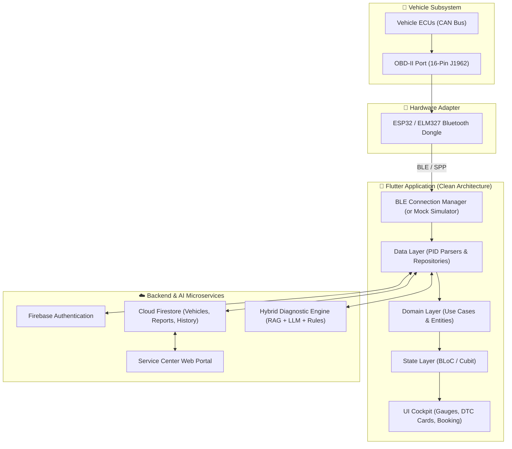

# 🚗 Intelligent OBD-II Vehicle Fault Diagnosis & Health Monitoring

[](https://github.com/dev-momensalman/OBD/releases/latest)
[](https://github.com/dev-momensalman/OBD/releases)

[](https://flutter.dev)
[](https://dart.dev)
[](https://bloclibrary.dev)
[](https://firebase.google.com)
[](#license)

An enterprise-grade, AI-powered automotive diagnostic and proactive health monitoring mobile application built with Flutter. The platform interfaces with vehicles via OBD-II (ELM327 / ESP32 custom dongle), continuously ingests telemetry, executes deterministic edge rules, and combines Machine Learning anomaly detection with Retrieval-Augmented Generation (RAG) and LLM explainability to deliver clear, actionable diagnostic reports.

---

## 📱 تحميل التطبيق (Download APK)

| الحزمة | الإصدار | الحجم | رابط التحميل المباشر |
| :--- | :---: | :---: | :--- |
| **Android Release APK** | `v1.0.0` | **62.9 MB** | [⬇️ **تحميل أحدث إصدار (Download APK)**](https://github.com/dev-momensalman/OBD/releases/download/v1.0.0/app-release.apk) |
| **GitHub Releases Hub** | Latest | All Builds | [📦 **جميع الإصدارات والتحميلات (Releases Page)**](https://github.com/dev-momensalman/OBD/releases) |
| **Direct Mirror Branch** | `v1.0.0` | **62.9 MB** | [🔗 **رابط التحميل البديل المباشر (Raw Download)**](https://github.com/dev-momensalman/OBD/raw/release/app-release.apk) |

---

---

## 🌟 Key Features

| Icon | Feature | Description |
|:---:|---|---|
| 📡 | **Dual-Mode OBD-II Telemetry** | Real-time sensor acquisition over Bluetooth Low Energy (BLE) or high-fidelity deterministic simulator. |
| 🔍 | **DTC Scan & Freeze Frame** | Reads Mode 03 confirmed trouble codes, Mode 07 pending codes, and Mode 02 freeze-frame engine snapshots. |
| 🧠 | **Hybrid AI Diagnostic Engine** | 4-tier pipeline: Deterministic Rules ➔ ML Anomaly Detection ➔ RAG Knowledge Retrieval ➔ LLM Explanation. |
| ⚠️ | **Proactive Early Fault Warning** | Anomaly detection on fuel trims, coolant thermals, and battery voltage before Check Engine Light illuminates. |
| 🛠️ | **Service Center & Booking** | Geo-located workshop discovery, AI cost estimation range, instant appointment booking, and live work order tracking. |
| 📊 | **Cockpit Dashboard** | Cyberpunk/Dark-themed dynamic dashboard with real-time tachometer, speed gauge, and health score dial. |

---

## 🏛️ System Architecture



---

## 🚀 Getting Started

### Prerequisites
- [Flutter SDK](https://docs.flutter.dev/get-started/install) 3.35.3 or higher
- [Dart SDK](https://dart.dev/get-dart) 3.9.2 or higher
- Android Studio / VS Code with Flutter extension
- Android device with Bluetooth 4.2+ (or emulator with Simulated Mode enabled)

### Installation
```bash
# Clone the repository
cd your_flutter_app

# Install dependencies
flutter pub get

# Run static analysis
flutter analyze

# Run tests
flutter test

# Launch app in simulated mode (no vehicle required)
flutter run
```

---

## 📁 Repository Structure

```
your_flutter_app/
├── AGENTS.md                  # Instructions and guardrails for AI coding agents
├── README.md                  # Project overview and getting started guide
├── docs/                      # Comprehensive 22-part technical specification suite
├── lib/                       # Production application source code
│   ├── core/                  # Shared configurations, network, errors, design system
│   ├── data/                  # Repositories, models, and BLE/Cloud datasources
│   ├── domain/                # Business logic, entities, and use cases
│   └── presentation/          # UI pages, widgets, and BLoC state containers
├── test/                      # Unit, widget, and integration test suite
└── pubspec.yaml               # Project dependencies and asset definitions
```

---

## 📜 Documentation Index
Complete architectural and business documentation is maintained in the [`docs/`](docs/) directory:
- [Project Brief](docs/PROJECT_BRIEF.md) • [Product Requirements Document (PRD)](docs/PRD.md)
- [System Design](docs/SYSTEM_DESIGN.md) • [Architecture](docs/ARCHITECTURE.md) • [Technical Spec](docs/TECHNICAL_SPEC.md)
- [User Stories](docs/USER_STORIES.md) • [User Flows](docs/USER_FLOWS.md) • [UI/UX Specification](docs/UI_UX_SPEC.md)
- [Database Schema](docs/DATABASE_SCHEMA.md) • [API Specification](docs/API_SPEC.md) • [Test Plan](docs/TEST_PLAN.md)
- [Implementation Plan](docs/IMPLEMENTATION_PLAN.md) • [Granular Tasks Backlog](docs/TASKS.md)
