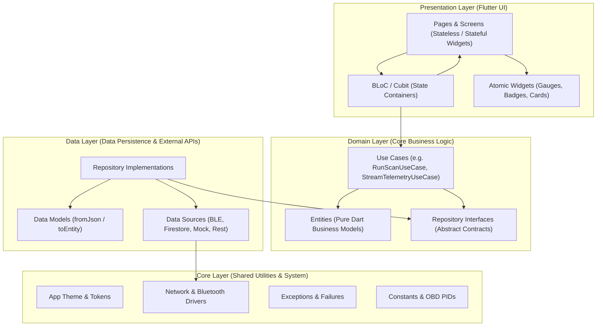

# 🏛️ ARCHITECTURE.md — Clean Architecture Blueprint for Flutter

> **Methodology:** Uncle Bob's Clean Architecture + Feature-First Modular Organization  
> **State Management:** `flutter_bloc` (Cubit / Bloc)  
> **Dependency Injection:** `get_it` Service Locator

---

## 1. Layer Responsibilities & Strict Boundaries



### Inviolable Architectural Rules
1. **Zero Flutter in Domain:** The `domain` layer must not import `package:flutter/...` or any platform packages. It is 100% pure Dart.
2. **Repository Contract Inversion:** Domain defines the abstract interface; Data implements it.
3. **Immutability:** All entity classes and BLoC states are immutable (`Equatable` or `freezed`).
4. **Error Handling via Either:** Use cases return `Either<Failure, Result>` (from `dartz` or `fpdart`) to ensure exhaustive compile-time error handling.

---

## 2. Directory Structure Blueprint

```
lib/
├── core/
│   ├── constants/
│   │   ├── app_colors.dart
│   │   ├── app_strings.dart
│   │   ├── obd_pids.dart
│   │   └── firebase_paths.dart
│   ├── errors/
│   │   ├── exceptions.dart
│   │   └── failures.dart
│   ├── network/
│   │   ├── ble_client.dart
│   │   └── api_client.dart
│   ├── theme/
│   │   ├── app_theme.dart
│   │   └── app_typography.dart
│   └── utils/
│       ├── bitmask_parser.dart
│       └── pid_decoder.dart
├── data/
│   ├── datasources/
│   │   ├── ble_obd_datasource.dart
│   │   ├── mock_obd_datasource.dart
│   │   ├── firebase_auth_datasource.dart
│   │   └── firestore_vehicle_datasource.dart
│   ├── models/
│   │   ├── telemetry_model.dart
│   │   ├── dtc_model.dart
│   │   ├── diagnostic_report_model.dart
│   │   └── service_center_model.dart
│   └── repositories/
│       ├── obd_repository_impl.dart
│       ├── diagnostic_repository_impl.dart
│       └── workshop_repository_impl.dart
├── domain/
│   ├── entities/
│   │   ├── telemetry_snapshot.dart
│   │   ├── dtc_fault.dart
│   │   ├── diagnostic_report.dart
│   │   ├── vehicle_profile.dart
│   │   └── work_order.dart
│   ├── repositories/
│   │   ├── i_obd_repository.dart
│   │   ├── i_diagnostic_repository.dart
│   │   └── i_workshop_repository.dart
│   └── usecases/
│       ├── connect_obd_usecase.dart
│       ├── stream_telemetry_usecase.dart
│       ├── run_diagnostic_scan_usecase.dart
│       ├── get_service_centers_usecase.dart
│       └── create_booking_usecase.dart
├── presentation/
│   ├── bloc/
│   │   ├── connection/
│   │   ├── dashboard/
│   │   ├── diagnostics/
│   │   └── booking/
│   ├── pages/
│   │   ├── home_dashboard_page.dart
│   │   ├── diagnostic_scan_page.dart
│   │   ├── diagnostic_report_page.dart
│   │   ├── service_center_page.dart
│   │   ├── booking_page.dart
│   │   ├── repair_tracker_page.dart
│   │   └── garage_history_page.dart
│   └── widgets/
│       ├── radial_gauge_widget.dart
│       ├── dtc_card_widget.dart
│       ├── glass_card_container.dart
│       ├── severity_banner_widget.dart
│       └── health_score_indicator.dart
└── injection_container.dart
```
