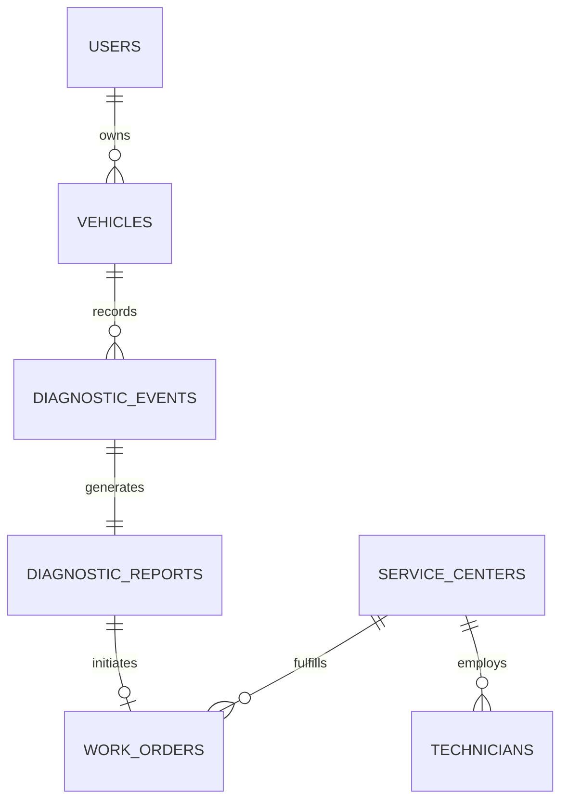

# 🗄️ DATABASE_SCHEMA.md — Cloud Firestore NoSQL Database Specification

> **Platform:** Google Cloud Firestore (Multi-tenant NoSQL Document Store)  
> **Source:** SRS §8.2 Platform Entities & Data Requirements

---

## 1. Entity-Relationship Overview



---

## 2. Firestore Collections & Document Schemas

### 2.1 Collection: `users/{userId}`
Stores user account profiles and role permissions.
```json
{
  "id": "usr_98234123",
  "fullName": "Ahmed Sallam",
  "email": "ahmed.sallam@example.com",
  "phoneNumber": "+201001234567",
  "role": "VEHICLE_OWNER", // "VEHICLE_OWNER" | "TECHNICIAN" | "WORKSHOP_ADMIN" | "SUPER_ADMIN"
  "createdAt": "2026-10-13T04:00:00Z",
  "lastLoginAt": "2026-10-13T04:15:00Z",
  "activeVehicleId": "veh_toyota_corolla_2021"
}
```

### 2.2 Collection: `vehicles/{vehicleId}`
Represents a customer's vehicle in their cloud garage.
```json
{
  "id": "veh_toyota_corolla_2021",
  "ownerId": "usr_98234123",
  "vin": "JTDBR32E220194821",
  "make": "Toyota",
  "model": "Corolla",
  "year": 2021,
  "engineDisplacementCc": 1800,
  "fuelType": "Gasoline",
  "transmission": "Automatic",
  "odometerKm": 48500,
  "pairedDeviceId": "ESP32_OBD_A4C1",
  "healthScore": 92,
  "lastScanAt": "2026-10-13T03:30:00Z"
}
```

### 2.3 Collection: `diagnostic_reports/{reportId}`
The structured output produced by a completed diagnostic session.
```json
{
  "id": "rpt_99381029",
  "vehicleId": "veh_toyota_corolla_2021",
  "userId": "usr_98234123",
  "timestamp": "2026-10-13T03:30:00Z",
  "dtcs": [
    {
      "code": "P0301",
      "description": "Cylinder 1 Misfire Detected",
      "system": "Powertrain",
      "status": "CONFIRMED"
    }
  ],
  "freezeFrameSnapshot": {
    "engineRpm": 2150.0,
    "vehicleSpeedKmH": 68.0,
    "coolantTempC": 94.0,
    "calculatedLoadPercent": 58.5,
    "shortTermFuelTrimPercent": 7.8,
    "longTermFuelTrimPercent": 14.2
  },
  "severity": "WARNING", // "HEALTHY" | "INFO" | "WARNING" | "CRITICAL"
  "explanation": "Engine cylinder 1 is failing to achieve complete combustion under moderate engine load.",
  "rankedPossibleCauses": [
    {"cause": "Failing Ignition Coil on Cylinder 1", "probabilityPercent": 65},
    {"cause": "Fouled or Worn Spark Plug", "probabilityPercent": 25},
    {"cause": "Clogged Fuel Injector", "probabilityPercent": 10}
  ],
  "recommendedNextAction": "Swap Cylinder 1 ignition coil with Cylinder 2 and observe if misfire DTC follows.",
  "confidenceScore": 0.88,
  "isUncertainWarning": false,
  "estimatedRepairCost": {
    "minUsd": 75.0,
    "maxUsd": 160.0,
    "currency": "USD"
  }
}
```

### 2.4 Collection: `service_centers/{centerId}`
Certified automotive repair workshops.
```json
{
  "id": "center_cairo_elrehab_01",
  "name": "Apex Precision Automotive",
  "address": "Rehab City Mall 2, Workshop Zone, Cairo",
  "geoLocation": {"latitude": 30.0583, "longitude": 31.4922},
  "contactPhone": "+201229988776",
  "rating": 4.8,
  "reviewCount": 142,
  "supportedBrands": ["Toyota", "Honda", "Nissan", "Hyundai", "Kia", "Volkswagen"],
  "pricingTier": "MODERATE",
  "laborRatePerHour": 35.0,
  "isOpen": true
}
```

### 2.5 Collection: `work_orders/{orderId}`
Tracks customer repair booking and workshop progress.
```json
{
  "id": "wo_20261013_001",
  "userId": "usr_98234123",
  "vehicleId": "veh_toyota_corolla_2021",
  "serviceCenterId": "center_cairo_elrehab_01",
  "reportId": "rpt_99381029",
  "scheduledDate": "2026-10-15T10:00:00Z",
  "status": "IN_PROGRESS", // "SCHEDULED" | "CAR_ARRIVED" | "IN_DIAGNOSIS" | "IN_PROGRESS" | "READY_FOR_PICKUP" | "COMPLETED" | "CANCELLED"
  "assignedTechnician": "Tariq Mahmoud",
  "initialEstimateUsd": 110.0,
  "finalCostUsd": null,
  "technicianNotes": "Confirmed misfire on cylinder 1. Coil resistance out of spec. Replacing coil and plug.",
  "createdAt": "2026-10-13T04:10:00Z",
  "updatedAt": "2026-10-13T04:15:00Z"
}
```
