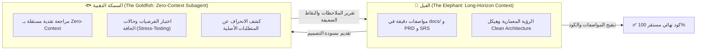

# 🐘🐟 EGM_MODEL_GUIDE.md — دليل نموذج الفيل والسمكة الذهبية من Google

> **المصدر:** مشروع Google مفتوح المصدر على GitHub: [`google/elephant-goldfish-model`](https://github.com/google/elephant-goldfish-model)  
> **التصنيف:** معمارية تطوير موجهة بالمواصفات (Spec-Driven Development) وتدقيق الكود بالذكاء الاصطناعي  
> **حالة التثبيت في البيئة:** ✅ مثبت بالكامل (`egm-review`, `egm-draft`, `egm-review-loop`, `egm-drift-report`, `egm-resolve`, `egm-brainstorm`)

---

## 💡 ما هو نموذج Elephant-Goldfish Model (EGM)؟

نموذج ابتكره فريق الذكاء الاصطناعي في **Google** لحل أكبر مشكلتين تواجهان المطورين عند استخدام الذكاء الاصطناعي في المشاريع الكبيرة:
1. **الذاكرة المفرطة والتحيز التراكمي (The Elephant Blind Spot):** عندما تستمر جلسة الشات لفترة طويلة، يمتلئ السياق بافتراضات غير مدققة ومجاملات وتبريرات تقود في النهاية إلى أخطاء معمارية (Hallucinations).
2. **فقدان السياق في المهام القصيرة (The Goldfish Problem):** النماذج السريعة تفقد الرؤية العامة للبنية التحتية والمواصفات الكاملة.

### الحل العبقري: ثنائية الفيل والسمكة الذهبية

---

## 🛠️ حزمة مهارات EGM المثبتة في المشروع

| المهارة (Skill) | الأمر المباشر | الوظيفة في مشروعنا |
|---|---|---|
| **`egm-brainstorm`** | `/egm-brainstorm` | عصف ذهني هندسي لاختبار الفكرة وتحويلها إلى متطلبات تقنية دون تسرع. |
| **`egm-draft`** | `/egm-draft` | تحويل المتطلبات إلى مستندات تصميم معمارية دقيقة خطوة بخطوة. |
| **`egm-review`** | `/egm-review` | إطلاق مراجع "السمكة الذهبية" (Zero-Context) لفحص التصميم عبر 5 مراحل نقدية صارمة. |
| **`egm-review-loop`** | `/egm-review-loop` | دورة مراجعة متكررة حتى تصفير جميع المخاطر المعمارية. |
| **`egm-resolve`** | `/egm-resolve` | معالجة الملاحظات المعمارية وتنقيح المواصفات بقرارات حاسمة. |
| **`egm-drift-report`** | `/egm-drift-report` | مقارنة الكود المكتوب في `lib/` مع متطلبات `docs/` لاكتشاف أي انحراف فوراً. |

---

## 🛑 القواعد الإلزامية لبروتوكول EGM في هذا المشروع

1. **حظر المجاملة (No Glazing / Sycophancy):**  
   ممنوع على المراجع الثناء السطحي أو استخدام كلمات مثل "مذهل" أو "ممتاز" دون وجود دليل رقمي أو منطقي يثبت سلامة الكود.
2. **النقد أولاً (Critique First):**  
   حتى لو كان الكود جيداً، يجب البحث أولاً عما ينقصه: *ماذا لو انقطع اتصال البلوتوث فجأة؟ ماذا لو كانت حرارة المحرك غير مدعومة في موديل السيارة؟*
3. **الدليل قبل الإعلان (Proof Before Claim):**  
   لا يُعتبر أي كود مكتملاً إلا إذا تم تمريره عبر `flutter analyze` بنتيجة صفر تحذيرات و `flutter test` بنتيجة نجاح كاملة.
4. **تسليم عبر الملفات (Artifact-First Delivery):**  
   كتابة المواصفات والقرارات المعمارية في ملفات دائمة بمجلد `docs/` وليس تركها كنصوص عابرة في الشات.
