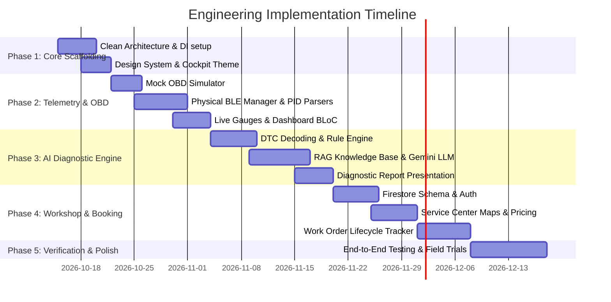

# 🗺️ IMPLEMENTATION_PLAN.md — Staged Engineering Roadmap

> **Target Timeline:** Sprints 1 to 6 (Full MVP Delivery)  
> **Strategy:** Incremental, test-driven delivery with active simulated fallback for rapid vibe coding.

---

## Phase Overview

---

## Detailed Sprint Milestones

### 🏁 Phase 1: Foundations, Design System & DI
- Setup `get_it` dependency injection container.
- Implement dark cockpit theme, responsive layouts, and typography.
- Implement atomic UI widgets: `GlassCardContainer`, `RadialGaugeWidget`, `HealthScoreIndicator`.

### 🏁 Phase 2: Dual-Mode OBD-II Telemetry
- Implement `IObdConnectionManager` with dual data sources:
  1. `MockObdDataSource`: Generates realistic sinusoidal RPM, thermal climbs, and simulated DTC triggers (`P0301`, `P0171`).
  2. `BleObdDataSource`: Connects to physical ESP32/ELM327 via `flutter_blue_plus`.
- Implement binary bitmask parsers and Mode 01 PID formulas.
- Connect live stream to `DashboardCubit` and render 60 FPS HUD.

### 🏁 Phase 3: Hybrid Diagnostic Engine & Reports
- Implement Mode 03 DTC reader and Mode 02 Freeze-Frame parser.
- Build Tier 1 Rule Engine for deterministic checks (overheating, low voltage).
- Implement Cloud Function / FastAPI gateway connecting vector search (RAG) and Gemini 1.5 Flash for grounded natural language synthesis.
- Construct the interactive `DiagnosticReportPage` with severity badges and ranked causes.

### 🏁 Phase 4: Cloud Garage & Service Center Booking
- Integrate Firebase Auth (Email/Google/Phone).
- Set up Cloud Firestore collections (`vehicles`, `diagnostic_reports`, `service_centers`, `work_orders`).
- Implement interactive map and workshop catalog with dynamic AI price range estimator.
- Build real-time repair tracker reflecting work order state transitions.

### 🏁 Phase 5: Hardening, Verification & Audit
- Run 3-level verification per SRS §10 (Software simulation, hardware simulation, real vehicle).
- Static analysis audit: Zero `flutter analyze` lints.
- Final documentation audit against PRD and SRS requirements.
