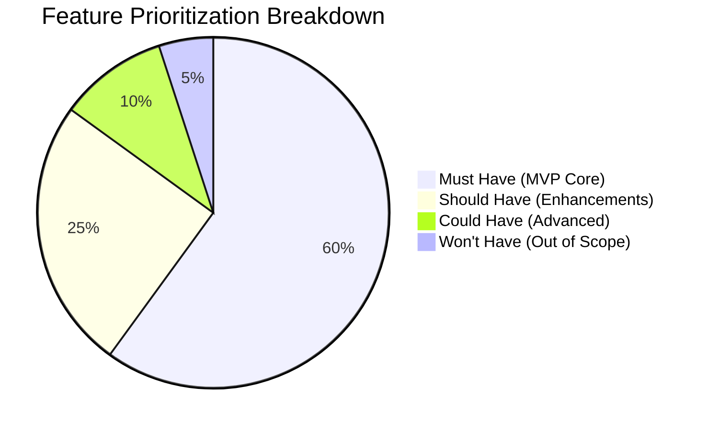

# 📋 PRD.md — Product Requirements Document

> **Document Status:** Approved • Baseline Specification  
> **Source Documents:** `PRD modified.pdf` & `SRS_Vehicle_Health_Diagnosis.pdf`  
> **System Name:** AI-Powered Vehicle Health & Predictive Diagnosis Platform  
> **Author:** Alaa-Allah Ahmed Sallam

---

## 1. Product Vision & Goals
To empower everyday vehicle owners with aerospace-grade telemetry insights and transparent, AI-interpreted diagnostic guidance, bridging the trust gap between drivers and automotive service centers.

---

## 2. Target User Personas

| Persona | Role | Key Goals & Needs |
|---|---|---|
| **Persona 1: Vehicle Owner (Casual)** | Everyday Commuter | Needs simple explanations of warning lights, cost estimates, safety urgency (can I drive?), and hassle-free repair booking. |
| **Persona 2: Vehicle Owner (Enthusiast)** | Automotive Hobbyist | Needs live sensor graphs (boost, fuel trims, coolant), historical telemetry logs, and DIY next diagnostic steps. |
| **Persona 3: Workshop Technician** | Certified Mechanic | Needs verified freeze-frame telemetry, ranked root causes, factory service bulletin references, and rapid triage tools. |
| **Persona 4: Workshop Manager** | Service Center Admin | Needs incoming digital bookings accompanied by complete pre-scan diagnostic reports to schedule labor and quote parts accurately. |

---

## 3. Core Functional Features Specification

### F-001: OBD-II Data Acquisition
- **Description:** Establish wireless BLE/WiFi/SPP communication with ELM327/ESP32 dongle connected to standard OBD-II port.
- **PIDs Supported:** Engine RPM (010C), Vehicle Speed (010D), Coolant Temperature (0105), Intake Air Temp (010F), MAF Flow Rate (0110), Throttle Position (0111), Fuel Trim Short/Long (0106/0107), Control Module Voltage (0142), Mode 03 Stored DTCs, Mode 07 Pending DTCs, Mode 02 Freeze-Frames.

### F-002: Vehicle Data Processing & Cleaning
- **Description:** Cleanse raw UART byte responses, handle checksums, parse binary bitmasks for supported PIDs, validate mathematical ranges, detect noise/outliers, and structure data for ingestion.

### F-003: DTC Interpretation & Fault Code Mapping
- **Description:** Decode standard 5-character SAE trouble codes (e.g., `P0300`, `P0171`, `C0035`, `B0001`, `U0100`). Map code to standard definition, affected subsystem (Powertrain, Chassis, Body, Network), and potential component failures.

### F-004: Intelligent Fault Analysis (Hybrid Engine)
- **Tier 1 (Rule Engine):** Deterministic evaluation of safety bounds (e.g., Coolant Temp > 115°C = Immediate Critical Engine Protection alert).
- **Tier 2 (ML Analysis):** Supervised classification of fault patterns and unsupervised anomaly scoring on multivariate time-series telemetry.
- **Tier 3 (RAG Retrieval):** Vector search across indexed factory repair manuals and OBD diagnostic guides.
- **Tier 4 (LLM Synthesis):** Structured generation of plain-language diagnosis, cause ranking, and recommended next inspection step.

### F-005: Root Cause Ranking & Uncertainty Communication
- **Description:** Present probable root causes in descending probability order (e.g., Ignition Coil: 70%, Spark Plug: 20%, Fuel Injector: 10%).
- **Guardrail:** Strictly present causes as probabilities, never as definitive assertions. If evidence is ambiguous, present a prominent uncertainty warning.

### F-006: Vehicle Health Dashboard & Live Cockpit
- **Description:** Real-time visual meters (circular dials, linear gauges, digital readouts) refreshing at ≥10 Hz. Aggregated Vehicle Health Index (0 - 100) based on telemetry deviations and active DTCs.

### F-007: Vehicle Diagnostic History & Cloud Garage
- **Description:** Persistent storage of diagnostic sessions, logged faults, telemetry graphs, and completed maintenance records linked by Vehicle Identification Number (VIN).

### F-008: Early Fault Detection & Predictive Trend Analysis
- **Description:** Detect subtle drifts in fuel trim (e.g., LTFT creeping past +15%) or abnormal thermal warmup curves before ECU registers a formal DTC.

### F-009: Service Center Recommender & Cost Estimator
- **Description:** Recommend nearest certified workshops matching the vehicle brand and diagnostic category. Generate transparent parts and labor price range estimations based on diagnostic evidence.

### F-010: Work Order Booking & Repair Tracking Lifecycle
- **Description:** Digital appointment scheduling, pre-scan attachment, technician work order dispatch, real-time repair status tracker (Received ➔ Diagnosing ➔ In Repair ➔ Quality Check ➔ Ready for Pickup), and post-repair history commit.

---

## 4. MoSCoW Feature Prioritization

- **Must Have (MVP):** F-001 (Data Acquisition), F-002 (Data Processing), F-003 (DTC Interpretation), F-004 (Hybrid Engine), F-005 (Cause Ranking), F-006 (Dashboard), F-007 (History), F-009 (Service Center & Estimates), F-010 (Booking & Work Orders).
- **Should Have:** F-008 (Early Fault Detection), Interactive Troubleshooting Questionnaire, Offline RAG Cache.
- **Could Have:** Vehicle Baseline Personalization, Automated Repair Verification Scan (Before/After comparison).
- **Won't Have:** Bi-directional ECU actuation/flashing, autonomous vehicle control, unverified mechanical guarantees.
