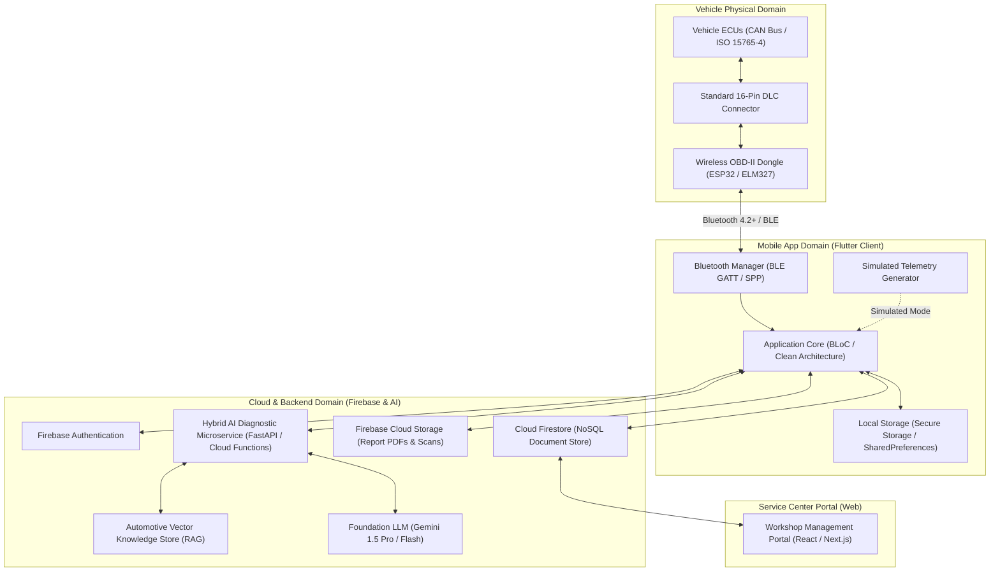

# 🏗️ SYSTEM_DESIGN.md — High-Level System Architecture & Component Design

> **Document Status:** Approved • Technical Specification  
> **Source:** SRS §2.1 & System Features §3  
> **System Scope:** Mobile App + OBD-II Dongle + Cloud AI Services + Workshop Portal

---

## 1. System Context & Top-Level Architecture

The platform comprises four interconnected tiers:

---

## 2. Component Specifications

### 2.1 Hardware Interface Layer (Dongle & Protocol)
- **Microcontroller:** ESP32-WROOM-32 with integrated CAN transceiver (SN65HVD230) or ELM327 v1.5/v2.1 microcontroller.
- **Physical Bus:** CAN 2.0B at 500 kbps (ISO 15765-4 11-bit & 29-bit IDs) and K-Line (ISO 9141-2 / ISO 14230-4).
- **Wireless Link:** Bluetooth Low Energy (BLE) GATT service or Classic Bluetooth SPP (Serial Port Profile).

### 2.2 Mobile Client Tier (Flutter)
- **Framework:** Flutter 3.35+ with Dart 3.9+.
- **Architectural Style:** Clean Architecture with Feature-First structure.
- **State Management:** BLoC / Cubit for unidirectional, predictable data flows.
- **Offline Capability:** Diagnostic reports and vehicles cached locally; queued for Firestore synchronization when online.

### 2.3 Cloud Persistence & Real-time Synchronization (Firebase)
- **Authentication:** Multi-provider (Email/Password, Phone OTP, Google Sign-In).
- **Cloud Firestore:** Distributed real-time database managing vehicles, scan events, diagnostic reports, service centers, and live work order status updates.
- **Cloud Functions:** Automated trigger on new diagnostic reports to execute push notifications and calculate workshop cost estimates.

### 2.4 Hybrid AI Diagnostic Microservice
- **Tier 1: Deterministic Rule Engine:** Instant hard checks on sensor thresholds (Coolant > 115°C, Voltage < 11.5V, Fuel Trim > ±25%).
- **Tier 2: ML Anomaly Detector:** Random Forest / Isolation Forest trained on time-series telemetry to detect subtle multi-parameter drift.
- **Tier 3: RAG Retrieval:** ChromaDB / Pinecone vector database populated with OEM repair procedures, technical service bulletins (TSBs), and standard SAE J2012 DTC definitions.
- **Tier 4: LLM Structured Generator:** Gemini 1.5 Flash generates plain-language user summaries, technician diagnostic steps, and confidence scores based strictly on retrieved facts.

---

## 3. Communication Protocols & Latency Budgets

| Link | Protocol | Target Latency | Throughput |
|---|---|---|---|
| **Dongle ➔ Mobile** | BLE GATT Characteristic (Notify/Write) | < 100 ms | 10 - 20 PID queries/sec |
| **Mobile ➔ Firestore** | HTTPS / gRPC WebSocket | < 300 ms | Event-driven |
| **Mobile ➔ AI Service** | REST / HTTPS (JSON Payload) | < 2.5 seconds | Per diagnostic session |
| **Portal ➔ Firestore** | Firestore Realtime Listener | < 200 ms | Push updates |
