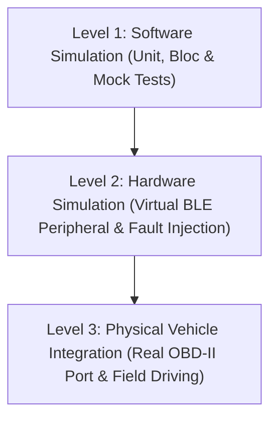

# 🧪 TEST_PLAN.md — 3-Level Verification & Quality Assurance Strategy

> **Testing Frameworks:** `flutter_test`, `bloc_test`, `mocktail`  
> **Source:** SRS Section 10 (Verification and Testing Requirements)

---

## 1. Three-Tier Verification Hierarchy



### Level 1: Software Simulation (In-Repo Automated Tests)
- **Scope:** Pure Dart mathematical PID formulas, Bitmask decoders, Rule Engine edge-cases, BLoC state streams.
- **Scenarios Tested:**
  - Standard operating values (RPM: 800 - 6500, Speed: 0 - 200 km/h, Coolant: 85 - 95°C).
  - Extreme Overheating Scenario (Coolant: 118°C ➔ Triggers `CRITICAL` Severity banner).
  - Low Battery / Alternator Failure Scenario (Voltage: 10.8V ➔ Triggers Warning banner).
  - DTC Misfire Simulation (Returns `P0301` + Freeze-Frame ➔ Triggers AI RAG Pipeline).

### Level 2: Hardware Simulation (Benchtop Rig)
- **Scope:** ESP32 running an ELM327 mock firmware over BLE.
- **Scenarios Tested:**
  - Bluetooth reconnect on connection loss (drop connection during active 10 Hz telemetry poll).
  - Malformed packet rejection (UART noise injection, missing byte checksums, buffer overruns).
  - Command timeout recovery (`NO DATA`, `BUS BUSY`, `CAN ERROR`).

### Level 3: Physical Vehicle Field Trials
- **Scope:** Physical vehicle road testing with paired mobile phone.
- **Scenarios Tested:**
  - Verify supported PIDs bitmask on target vehicles (Toyota, Hyundai, Ford).
  - End-to-end MVP Acceptance Flow: Plug dongle ➔ Read live sensors ➔ Run full scan ➔ Generate AI report ➔ Book nearest workshop.

---

## 2. Test Execution Commands

```bash
# Run all unit and bloc tests
flutter test

# Run tests with code coverage report
flutter test --coverage

# Run static analysis linter
flutter analyze
```
