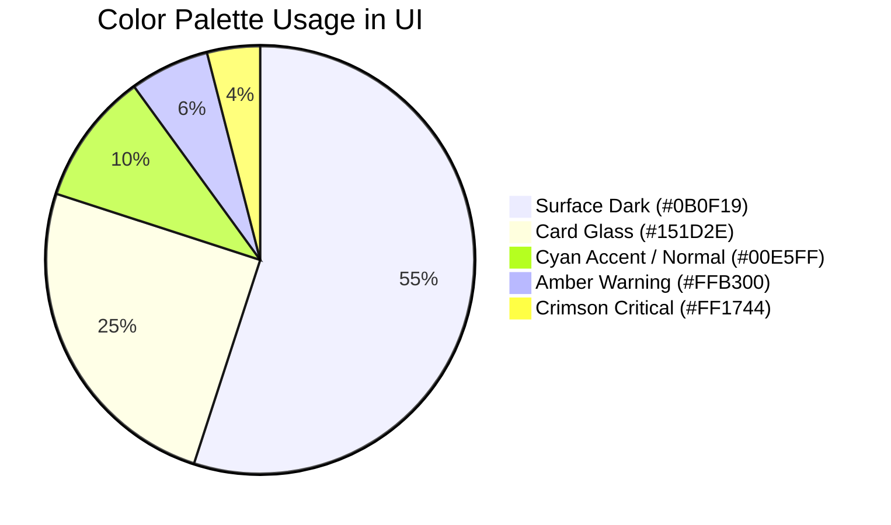

# 🎨 UI_UX_SPEC.md — Design System & Interaction Specification

> **Theme:** Dark Automotive Cockpit • High-Contrast HUD • Glassmorphism  
> **Target Framework:** Flutter • Responsive & Adaptive UI

---

## 1. Visual Theme & Color Palette

The interface is engineered to evoke high-tech vehicle telematics with deep contrast for low glare inside vehicle cabins during day or night driving.



| Token Name | Hex Code | Purpose / Semantic Context |
|---|---|---|
| `bg_surface` | `#0B0F19` | Main application background (Deep Midnight Carbon) |
| `card_surface` | `#151D2E` | Container cards, bottom navigation bar, modal sheets |
| `card_border` | `#232E48` | Subtle borders for glassmorphism panels |
| `accent_cyan` | `#00E5FF` | Primary action buttons, active tab indicators, normal readings |
| `accent_teal` | `#00BFA5` | Healthy vehicle status badges (100% Health, PASS checks) |
| `warning_amber` | `#FFB300` | Warning DTCs, moderate thermal elevation, pending inspection |
| `critical_red` | `#FF1744` | Immediate safety stops, critical DTCs (Overheating, Brake fail) |
| `text_primary` | `#F8FAFC` | Main headings, high-priority telemetry numbers |
| `text_secondary` | `#94A3B8` | Subtitles, parameter units (`RPM`, `km/h`, `°C`), timestamps |

---

## 2. Typography Guidelines (Google Fonts: Outfit / Space Grotesk)

| Style Variant | Font Family | Size | Weight | Line Height | Usage |
|---|---|---|---|---|---|
| `Display Hero` | `Outfit` | `36sp` | Bold (700) | `44sp` | Big Speedometer / Tachometer Numbers |
| `Headline 1` | `Outfit` | `24sp` | SemiBold (600) | `30sp` | Screen Headers, Health Score (e.g. 94/100) |
| `Headline 2` | `Outfit` | `18sp` | Medium (500) | `24sp` | Card Titles, Diagnostic Section Names |
| `Body Regular`| `Outfit` | `14sp` | Regular (400) | `20sp` | Diagnostic Explanations, User Guides |
| `Telemetry Code`| `Space Grotesk`| `13sp` | Medium (500) | `16sp` | DTC Code tags (`P0301`), Hex byte packets |

---

## 3. Atomic Widgets & Components

### A. Telemetry Gauge Widget (`CockpitRadialGauge`)
- Circular SVG/CustomPainter gauge with glowing gradient arc.
- Center displays live numerical value + secondary unit label.
- Color dynamically transitions: Cyan (Safe: 0-85°C) ➔ Amber (Warning: 86-105°C) ➔ Red (Hazard: >105°C).

### B. Diagnostic Trouble Code Card (`DtcCodeCard`)
- Glassmorphic card displaying:
  - DTC Badge (e.g., `P0301` in red/amber font with pill border)
  - Plain-language title (e.g., "Cylinder 1 Misfire Detected")
  - System Tag (e.g., `Powertrain / Ignition`)
  - Freeze-Frame Quick Peek button (expands to show Engine Load, RPM, Temp at trigger time).

### C. Severity Alert Banner (`SeverityBanner`)
- Three distinct variants:
  - 🟢 **Healthy / Minor:** "Vehicle operating within normal tolerances."
  - 🟡 **Caution / Service Soon:** "Fault detected. Safe to drive, but inspect within 300 km."
  - 🔴 **Critical / Immediate Stop:** "Severe engine hazard detected. Turn off vehicle immediately."

### D. AI Explanation & Disclaimers Box
- Displays plain-language AI synthesis with an explicit badge: `[🤖 AI Augmented Analysis - Probabilistic]`.
- Footnote with legal safety disclaimer per SRS Section 6.2.

---

## 4. Application Screen Wireframes & Navigation Tree

The application is structured into four primary bottom navigation tabs:

```
[Main Navigation Bar]
├── 🏠 Tab 1: Cockpit Dashboard (Health Score, Live Gauges, Quick Scanner Bar)
├── 🔍 Tab 2: Diagnostic Scan (Run Scan, Active DTCs, AI Report, Freeze-Frame)
├── 🛠️ Tab 3: Service & Repairs (Map Finder, Cost Estimator, Work Order Tracker)
└── 🚗 Tab 4: My Garage & History (Vehicle Profile, Past Reports, Connection Settings)
```
