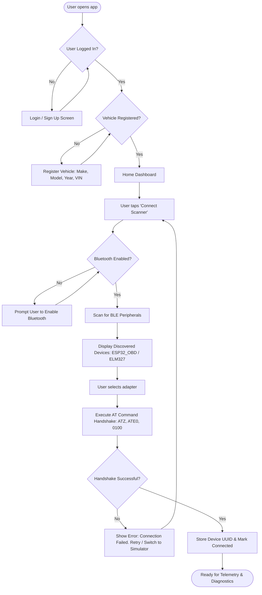
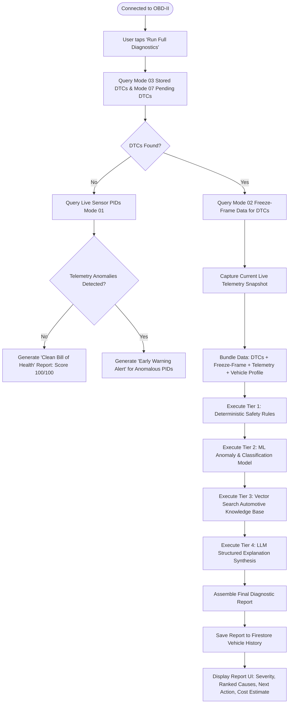

# 🔄 USER_FLOWS.md — System User Flows & Interaction Journeys

> **Scope:** Complete end-to-end user navigation & state transitions  
> **Source:** SRS §2.1.1, Use Cases UC-01 through UC-06, and Sequence Diagrams SD-01 through SD-13

---

## 1. Flow 1: Device Onboarding & Bluetooth Pairing (SD-01)



---

## 2. Flow 2: Live Diagnostic Scan & AI Report Generation (SD-02, SD-03, SD-04)



---

## 3. Flow 3: Service Center Discovery & Booking Lifecycle (SD-05, SD-06, SD-07, SD-08)

```mermaid
flowchart TD
    ReportView([User Views Diagnostic Report]) --> TapFindHelp[User taps 'Find Certified Workshops']
    TapFindHelp --> GetLocation[Retrieve Current GPS Location]
    GetLocation --> QueryCenters[Query Firestore Service Centers matching Make & Region]
    QueryCenters --> DisplayMap[Show Interactive Map & Workshop Cards with Price Ranges]
    
    DisplayMap --> SelectCenter[User selects Workshop]
    SelectCenter --> ChooseSlot[Select Preferred Date & Timeslot]
    ChooseSlot --> ReviewQuote[Review Cost Estimate: Parts + Labor Breakdown]
    ReviewQuote --> ConfirmBooking[User taps 'Confirm Appointment']

    ConfirmBooking --> CreateWorkOrder[Create WorkOrder in Firestore: Status = 'SCHEDULED']
    CreateWorkOrder --> NotifyCenter[Push Notification sent to Service Center Portal]
    NotifyCenter --> CustomerTrack[Customer opens 'Repair Tracker' Screen]

    subgraph WorkshopLifecycle["Workshop Repair Lifecycle"]
        CustomerTrack --> StatusScheduled[Status: SCHEDULED]
        StatusScheduled --> CarDropped[Customer Drops Car at Center]
        CarDropped --> StatusDiagnosing[Status: IN_DIAGNOSIS (Technician Verifies)]
        StatusDiagnosing --> StatusRepairing[Status: IN_REPAIR]
        StatusRepairing --> StatusQC[Status: QUALITY_CHECK & CLEAR_DTC]
        StatusQC --> StatusReady[Status: READY_FOR_PICKUP]
    end

    StatusReady --> PushReady[Send Push Notification to Owner: 'Your car is ready!']
    PushReady --> PickupCar[Owner Picks Up Vehicle & Approves Invoice]
    PickupCar --> UpdateCarHistory[Update Vehicle Historical Maintenance Ledger: Status = 'COMPLETED']
```
